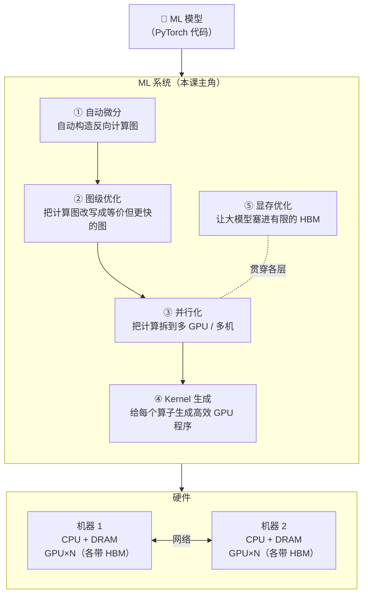
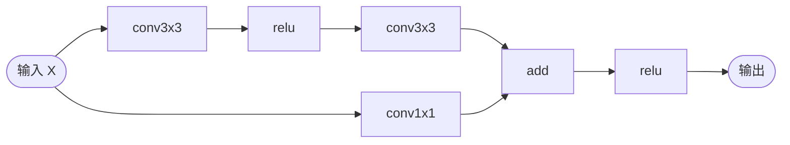
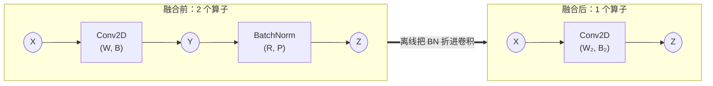
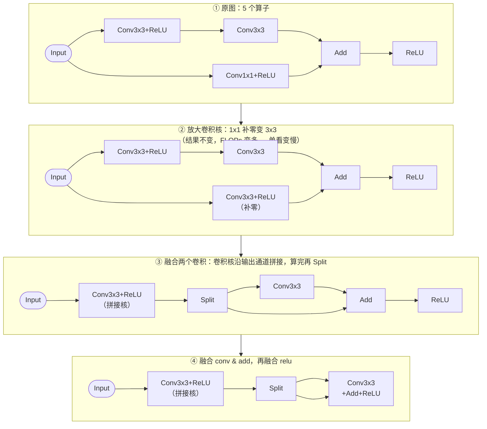
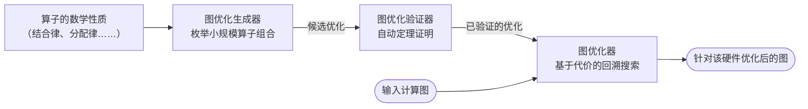
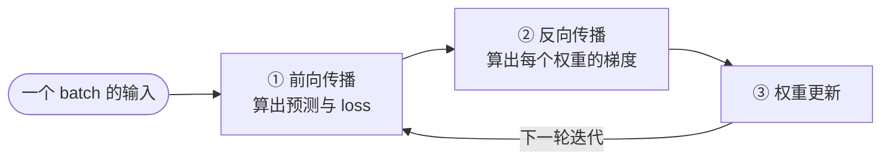
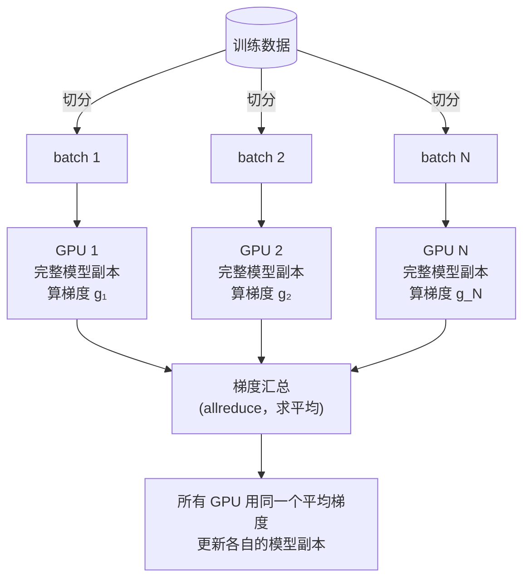
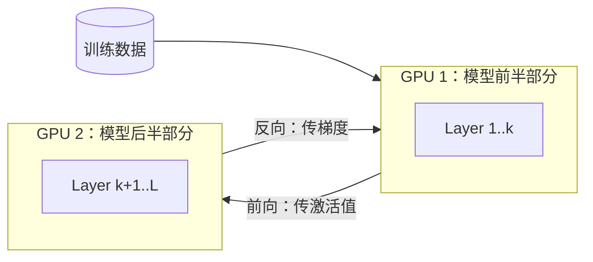
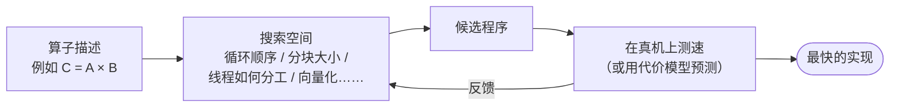
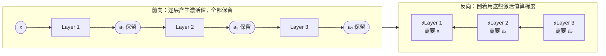

# Lecture 2 · Introduction to Machine Learning Systems

> **课程**：CMU 15-442/642 Machine Learning Systems（Spring 2026）
> **讲次**：第 2 讲（2026/01/14）
> **Slides**：<https://mlsyscourse.org/slides/02-introduction-to-MLSys.pdf>
> **备注**：slides 页脚印的是贾志豪（Zhihao Jia）在 Stanford 时期的报告信息；他的博士论文题目就是 *Automated Discovery of Machine Learning Optimizations*，和本讲内容是同一条主线。
>
> 📌 本笔记中的图使用 Mermaid 绘制，公式使用 LaTeX。Typora、Obsidian、GitHub 可以直接显示；VS Code 需要安装 *Markdown Preview Mermaid Support* 插件。

---

## 0. 一句话总结

**ML 系统是夹在「模型」和「硬件」之间的几层软件，负责把一个模型变成在一堆 GPU 上高效运行的程序。** 本讲给出整门课的地图：自动微分、图级优化、并行化、Kernel 生成、显存优化。它反复强调一个观点：**最优方案取决于具体的模型和硬件，手工规则跟不上，应该让机器自动搜索。**

---

## 1. 全景图：ML 系统的五层

每一层在本课中的位置：

| 层 | 要解决的问题 | 后续讲次 / 作业 |
|---|---|---|
| ① 自动微分 | 用户只写前向，系统自动生成反向 | Automatic Differentiation；**Lab 1** |
| ② 图级优化 | 改写计算图（算子融合、替换） | ML Superoptimization |
| ③ 并行化 | 一块 GPU 算不动、放不下 | ML Parallelization ×2；**Lab 2** |
| ④ Kernel 生成 | 每个算子怎么写成最快的 GPU 程序 | Optimizing Linear Algebra、CUDA ×2、GEMM on Modern GPUs；**Lab 3** |
| ⑤ 显存优化 | 显存装不下激活值和参数 | Memory Optimizations |

> 💡 **用 61C 的眼光看**：这一整套东西就是专门为「张量程序」设计的**编译器 + 运行时**。

---

## 2. 计算图：DNN 的「中间表示」

DNN 可以表示成一张有向无环图：

- **节点**：张量算子（卷积、矩阵乘、ReLU……）
- **边**：张量（n 维数组），即数据在算子之间的流动

它和编译器里的数据流 IR 是同一回事。**图级优化 = 在不改变计算结果的前提下改写这张图**，就像编译器在 IR 上做常量折叠、指令合并。

---

## 3. 图级优化（本讲核心）

### 3.1 典型例子：Conv + BatchNorm 融合

**推导**

卷积（$c$ 是输出通道，$d$ 是输入通道，$u, v$ 是卷积核内的位置）：

$$
Y(n,c,h,w) = \sum_{d,u,v} X(n,d,h+u,w+v)\cdot W(c,d,u,v) + B(c)
$$

推理时的 BN，对每个输出通道 $c$ 做一次仿射变换：

$$
Z = Y\cdot R(c) + P(c),\qquad R = \frac{\gamma}{\sqrt{\sigma^2+\epsilon}},\quad P = \beta - \mu R
$$

把 $Y$ 代入：

$$
Z = \sum_{d,u,v} X\cdot\underbrace{W(c,d,u,v)\,R(c)}_{W_2} + \underbrace{B(c)\,R(c) + P(c)}_{B_2}
$$

于是 BN 被「吸收」进卷积，整张图里只剩一个用新权重 $W_2, B_2$ 的卷积。

**为什么会变快？**

1. $W_2, B_2$ 只需离线算一次。
2. 运行时少一个算子，也就少一次 kernel 启动。
3. **最关键的一点**：中间结果 $Y$ 不用写回显存再读出来，访存量大幅减少。用 61C 的话说，就是减少了对慢速存储层级的访问。

**⚠️ 只能用于推理，不能直接用于训练**

| 参数 | 来源 | 训练时 | 推理时 |
|---|---|---|---|
| $\gamma, \beta$ | 可学习参数，由反向传播更新 | 每步都在变 | 冻结 |
| $\mu, \sigma^2$ | **当前 mini-batch 的统计量**（不是学出来的） | 每个 batch 都不同，**取决于输入数据本身** | 使用训练时维护的滑动平均（固定值） |

训练时 $R, P$ 依赖当前 batch 的数据，不是常量，所以不能提前乘进 $W$。

### 3.2 传统做法：规则式优化及其局限

专家手写「看到模式 A 就改写成 B」的规则，比如融合 conv+relu、融合 conv+BN、合并多个卷积等。TensorFlow 约有 **200 条规则、约 5.3 万行代码**。

| 局限 | 含义 | 例子 |
|---|---|---|
| **鲁棒性** Robustness | 专家的启发式不适用于所有模型和硬件 | 有用户反映开启 XLA 后反而变慢；ResNet 例子中 V100 快、K80 慢 |
| **可扩展性** Scalability | 新算子、新结构都需要新规则 | 光是优化卷积就有约 4K 行代码 |
| **性能** Performance | 漏掉针对特定模型或硬件的细微优化 | 「先变慢、后变快」的改写序列 |

### 3.3 动机例子：ResNet 残差块的四步改写

**结果：最终的图在 V100 上快 30%，在 K80 上却慢 10%。**

两个教训：

1. **局部变慢可能是全局变快的前提**。第 ② 步单看是负优化，但没有它就做不了第 ③ 步。只会「每步都变快」的贪心规则发现不了这条路径。
2. **最优的图依赖硬件**。同一组改写在不同 GPU 上效果相反，一套固定规则不可能对所有硬件都对。

> 第 ③ 步为什么快：输入只读一次，而不是两次；一个大卷积比「一大一小」两个卷积更能喂饱 GPU；kernel 启动次数也更少。补零多出来的计算量，和省下的访存、启动开销相比代价很小。

### 3.4 自动化方案：TASO 的思路

- **生成器**：在小规模上枚举算子组合，找出「计算结果等价的子图对」。这样规则是机器自动产生的，不用人手写。
- **验证器**：用算子的数学性质形式化证明两边确实等价，保证正确性。
- **优化器**：在真实的大图上，用针对目标硬件的代价模型搜索怎么应用这些替换。**回溯搜索允许暂时变慢**，正好对应 ResNet 例子的第 ② 步。

TASO 把「写规则」变成了「自动生成规则 + 自动选择用法」，同时缓解了上面三个局限。

---

## 4. 并行化

### 4.1 回顾 SGD

更新公式：

$$
w_i \leftarrow w_i - \gamma\nabla L(w_i) = w_i - \frac{\gamma}{n}\sum_{j=1}^{n}\nabla L_j(w_i)
$$

**关键观察**：梯度是**对样本求和（取平均）**，而求和可以拆开分别算，再加起来。

### 4.2 数据并行

1. 把训练数据切成多个 batch。
2. 每块 GPU 用自己的 batch 算梯度。
3. 在 GPU 之间汇总梯度，然后各自用同样的结果更新模型。

**每轮通信的内容：梯度。** 前提是每块 GPU 都放得下完整模型。

### 4.3 模型并行

把模型切成多个子图，放到不同设备上，设备之间传递**中间结果**。适用于**模型太大、单卡放不下**的情况。

### 4.4 对比

| | 数据并行 | 模型并行 |
|---|---|---|
| 切什么 | 切数据 | 切模型 |
| 每块 GPU 上 | 完整模型 | 部分模型 |
| 设备之间传什么 | 梯度 | 激活值（前向）/ 梯度（反向） |
| 解决什么问题 | 算得不够快 | 放不下 |
| 后续展开 | ZeRO（Lab 2） | 张量并行（Lab 2）、流水线并行 |

---

## 5. Kernel 生成

**问题**：图优化完后，每个算子（conv、matmul……）都要变成真正在 GPU 上跑的程序。

**传统做法：厂商手写算子库**

- cuDNN（如 `cudnnConvolutionForward()`）、cuBLAS（如 `cublasSgemm()`）、cuRAND、cuSPARSE……
- ❌ 新算子出现时库里还没有，无法立即支持
- ❌ 硬件越来越复杂，手写 kernel 越来越难做到最优

**自动化做法：搜索高性能程序**

- ✅ 新算子立即可用
- ✅ 可能比手写 kernel 更快

> 🔗 **61C 联系**：Lab 7 比较矩阵乘法六种循环顺序、调分块大小，本质上就是在手动搜索一个很小的空间。GPU 上的空间大得多，所以要交给机器（如 TVM）去搜。

---

## 6. 显存优化

- 能训练的最大模型受 **GPU 显存** 限制，而更大的模型通常效果更好。
- 训练比推理费显存得多，主要原因是**前向的中间结果（激活值）必须一直保留到反向用完**。

**为什么必须保留？** 以 $y = Wx$ 为例：

$$
\frac{\partial L}{\partial W} = \frac{\partial L}{\partial y}\, x^{\top}
$$

反向时必须用到前向时的输入 $x$。

**后续讲次的两个方向**（Memory Optimizations 那讲）：

- **重算**（rematerialization / checkpointing）：只存一部分激活值，其余在反向需要时重新计算，用计算换显存。
- **卸载**（offload）：把暂时用不到的数据搬到 CPU 内存，用 PCIe 带宽换显存。

---

## 7. 与 61C 的知识联系

| 本讲概念 | 61C 中对应的知识 |
|---|---|
| 算子融合减少中间结果读写 | 内存层级、cache、减少对慢速存储的访问 |
| Kernel 搜索（循环顺序、分块） | Lab 7 矩阵乘法循环顺序与分块；Project 4 numc 性能优化 |
| 数据并行 | 数据级并行（SIMD）、MapReduce 的「切数据、各算各的、再汇总」 |
| 显存装不下 | 存储层级容量限制；后面的 PagedAttention 借用了虚拟内存分页思想 |

---

## 8. 课堂检查题回顾（第一段）

**Q1. Conv+BN 融合为什么只适用于推理？**

- 我的回答：μ、σ 等参数通过反向传播确定，不能提前知道。
- 讲评：结论对，理由需修正。γ、β 由反向传播学习；**μ、σ² 是当前 mini-batch 的统计量**，取决于输入数据，每个 batch 都不同。所以训练时 $R, P$ 不是常量，无法离线折进 $W$。推理时使用固定的滑动平均，才能融合。

**Q2. 1×1 补零成 3×3 后 FLOPs 变多，为什么整体可能变快？**

- 我的回答：尺寸一致后可以拼接卷积核一起算，减少算子、kernel 启动和读写次数。✅
- 补充：输入只需读一次；一个大卷积比小卷积更能喂饱 GPU。

**Q3. 「V100 快 30%、K80 慢 10%」暴露了哪个局限？**

- 我的回答：性能；规则数量庞大，新规则要避免冲突。
- 讲评：主要对应**鲁棒性**（启发式不适用于所有硬件）。「规则太多难维护」属于**可扩展性**。「先变慢后变快的路径被漏掉」才属于**性能**。难以手写解决的根本原因是：规则不知道目标硬件上的真实代价，要做对就得按「模型 × 算子 × 硬件」分别写规则，组合会爆炸。

---

## 9. 自测题（先自己答，再展开对照）

**1. 为什么 SGD 天然适合数据并行？**

参考答案

因为 batch 的梯度是各样本梯度的平均 $\frac{1}{n}\sum_j \nabla L_j$，求和可以拆成多段分别算再相加。每块 GPU 算自己那部分数据的梯度，汇总后的结果和单卡算整个 batch 是一样的。

**2. 数据并行和模型并行，每轮迭代中 GPU 之间分别要传什么？**

参考答案

数据并行传**梯度**，用于汇总求平均。模型并行传**中间结果**：前向传激活值给下一段，反向把梯度传回上一段。

**3. 什么情况下只靠数据并行解决不了问题，必须考虑切分模型？**

参考答案

当模型本身（参数，加上训练所需的梯度、优化器状态、激活值）大到单块 GPU 显存放不下时。数据并行要求每块 GPU 都有完整的模型副本，这时就做不到了。

**4. 厂商手写算子库（cuDNN / cuBLAS）有哪两个问题？自动 kernel 生成怎么解决？**

参考答案

一是新算子出现时无法立即支持；二是硬件越来越复杂，手写 kernel 难以做到最优。自动生成把各种实现方式看作搜索空间，在真机上测速或用代价模型挑选最快的版本，所以新算子能立即可用，性能也可能超过手写。

**5. 训练为什么比推理需要多得多的显存？举一个公式说明。**

参考答案

训练时要保存前向的激活值，供反向计算梯度使用；而推理时用完即可丢弃。例如 $y = Wx$ 时，$\frac{\partial L}{\partial W} = \frac{\partial L}{\partial y}x^{\top}$，反向必须用到前向的输入 $x$。（此外训练还要存梯度和优化器状态，后面讲 ZeRO 时会细讲。）

**6.（综合）把本讲五层各用一句话说清楚，并说出它在本课对应哪个作业（如果有）。**

参考答案

① 自动微分：用户只写前向，系统自动构造反向图（Lab 1）。② 图级优化：把计算图改写成等价但更快的图（无作业）。③ 并行化：把计算拆到多卡多机（Lab 2）。④ Kernel 生成：为每个算子找到最快的 GPU 实现（Lab 3）。⑤ 显存优化：用重算、卸载等手段让模型放得下（无作业）。

---

## 10. 延伸阅读（可选，读摘要 + 引言 + 图即可）

- **TASO**：Jia et al., *TASO: Optimizing Deep Learning Computation with Automatic Generation of Graph Substitutions*, SOSP 2019（本讲图优化部分的来源）
- **FlexFlow**：Jia et al., *Beyond Data and Model Parallelism for Deep Neural Networks*, SysML 2019（自动搜索并行策略）
- **TVM**：Chen et al., *TVM: An Automated End-to-End Optimizing Compiler for Deep Learning*, OSDI 2018（自动 kernel 生成）
- **重算**：Chen et al., *Training Deep Nets with Sublinear Memory Cost*, 2016（显存优化）
