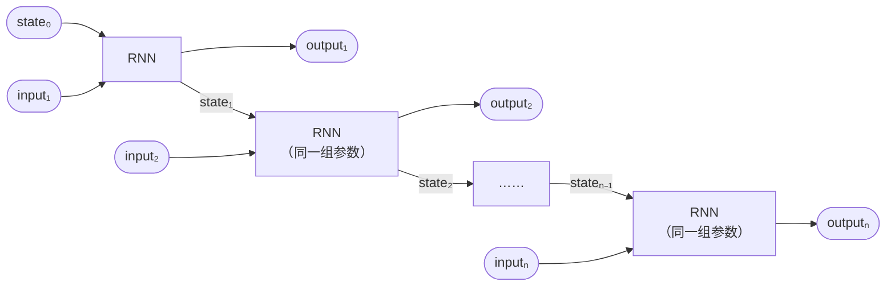
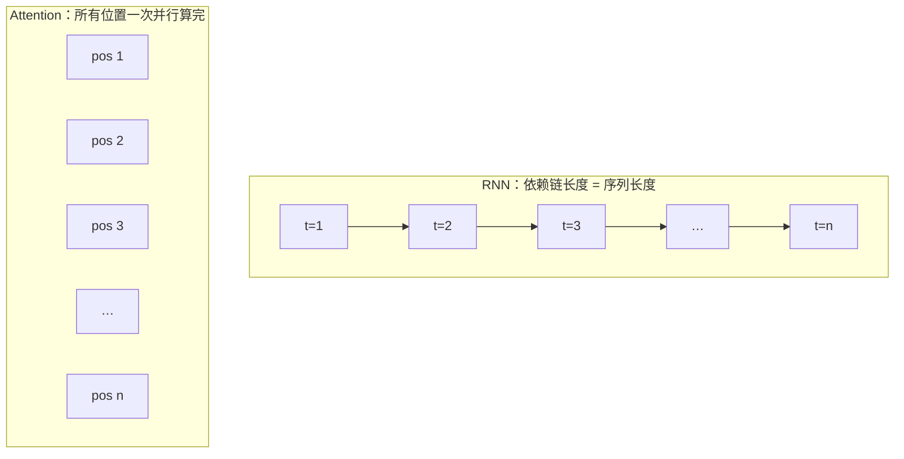
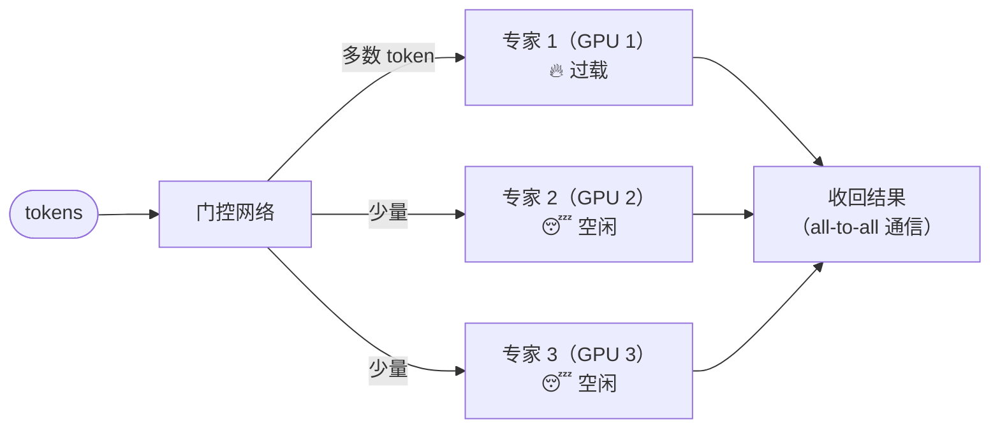
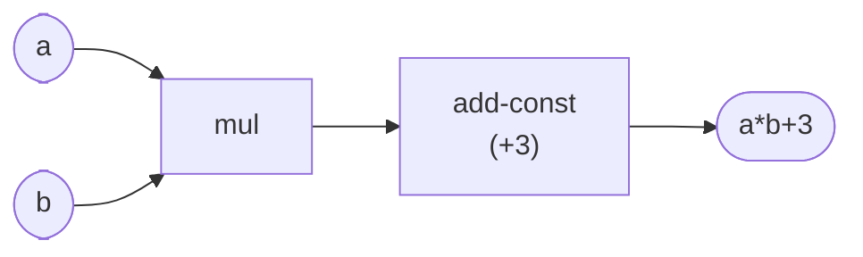
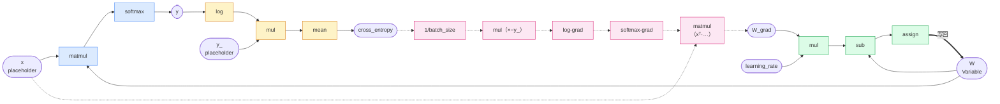
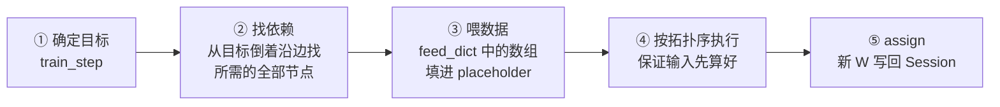
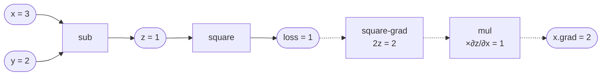

# Lecture 3 · Deep Learning and Programming Abstraction

> **课程**：CMU 15-442/642 Machine Learning Systems（Spring 2026）
> **讲次**：第 3 讲（2026/01/21，Tianqi Chen）
> **Slides**：<https://mlsyscourse.org/slides/03-deep-learning-programming-abstraction.pdf>
>
> 📌 本笔记中的图使用 Mermaid 绘制，公式使用 LaTeX。Typora、Obsidian、GitHub 可以直接显示；VS Code 需要安装 *Markdown Preview Mermaid Support* 插件。

---

## 0. 一句话总结

**深度学习框架提供给用户的「语言」是计算图。** 本讲先从系统的角度过一遍主流模型（每类模型给系统带来什么麻烦），再用 TF1 风格的逻辑回归代码，展示计算图是如何一步步搭出来、又是如何被执行的。最后对比两种建图方式：**先定义后运行**（TF1）和**边定义边运行**（PyTorch）。

---

## 第一部分：从系统的眼光看深度学习模型

### 1. 机器学习三要素（第 4–5 页）

| 要素 | 含义 | 例子 |
|---|---|---|
| 模型（假设类） | 带参数的函数，把输入映射成预测 | 逻辑回归 |
| 损失函数 | 衡量这组参数「做得有多好」 | 带正则项的交叉熵 |
| 训练方法 | 找到让损失最小的参数 | SGD |

深度学习**只改了第一项**：模型变成**多层组合**的函数，并且**端到端**地一起训练所有层。损失函数和训练方法不变。

> 💡 **对系统的意义**：不管模型长什么样，系统要支持的始终是同一个流程：**前向算 loss → 反向算梯度 → 更新参数**。框架只要把「任意的多层组合函数」表达好、求导好、算快，就能支持所有模型。

### 2. 五类模型给系统带来的问题（第 6–27 页）

| 模型 | 计算的核心特点 | 给系统带来的问题 |
|---|---|---|
| **CNN** | 卷积在空间上滑动做点积，计算密集且规则 | 相对友好；难点主要是把卷积 kernel 写到极致 |
| **RNN** | 有内部状态，第 t 步依赖第 t−1 步 | 计算图必须是 DAG，但 RNN 有自环；序列内部无法并行 |
| **Transformer** | 每个位置用 query 去「查询」所有位置的 value | 序列内可以大规模并行，代价是计算量随序列长度平方增长 |
| **GNN** | 先聚合邻居的表示，再做神经网络运算 | 每个节点的邻居数不同，访存不规则，类似稀疏计算 |
| **MoE** | 每个输入只交给少数几个「专家」处理 | 走哪个专家要运行时才知道；负载可能不均衡；需要 all-to-all 通信 |

#### 2.1 RNN 如何放进计算图：展开（第 16 页）

计算图必须是**有向无环图**，而 RNN 的状态会循环回自身。解决办法是设定一个最大长度，把同一个 RNN 单元**展开**成一条链。所有副本**共享同一组参数**。



**展开带来的问题：长度不一的 batch**

- **比最大长度短**：要**填充（padding）**到最大长度，补出来的位置白白参与计算，还需要**掩码（mask）**防止它们影响 loss 和梯度。
- **比最大长度长**：图里没有多余的副本可用，只能**截断**（丢信息），或者另建一张更长的图。
- 折中办法是**分桶（bucketing）**：长度相近的句子放进同一个 batch，每个长度区间建一张图。
- 用边定义边运行的框架（PyTorch），这个问题天然就消失了（见第二部分第 5 节）。

#### 2.2 RNN 慢、Attention 快（第 19–21 页）

- **RNN**：第 i 个状态必须等前面所有状态算完，前向和反向都有 **O(序列长度)** 个无法并行的步骤。
- **Attention**：每个位置直接拿自己的表示当 query，去和所有位置交互。无法并行的步骤数**不随序列长度增长**，整层可以一次性用大矩阵乘法算完。
- **关键洞察**：决定 GPU 上耗时的不是总计算量，而是**必须串行执行的最长依赖链**。Attention 的总 FLOPs 更多（序列长度的平方），但依赖链短，所以反而更快。用 61C 的话说，这就是 Amdahl 定律。



#### 2.3 MoE 的系统问题（第 26–27 页）

门控网络为每个 token 挑选少数几个专家。Switch Transformer 把 Transformer 中的前馈层换成了 MoE 层：参数量可以很大，而每个 token 的计算量基本不变。



| 系统问题 | 说明 |
|---|---|
| 负载不均衡 | 「热门」专家所在的 GPU 拖慢整体；设容量上限后，超出的 token 会被丢弃或绕过 |
| 通信开销 | 每个 MoE 层都有两次 all-to-all：把 token 发给专家，再把结果收回来 |
| 形状动态 | 每个专家收到多少 token，要到运行时才知道，难以提前分配显存、调优 kernel |

> ⚠️ 「不同专家能力不同」属于模型质量（学习）问题，不是系统问题。系统问题要站在 GPU 和网络的角度去想。

### 3. 应用决定系统设计（第 29–31 页）

| 应用领域 | 用户写的「语言」 | 系统因此需要 |
|---|---|---|
| 数据管理 | 声明式的 SQL | 执行计划器、存储引擎 |
| 数据处理 | MapReduce 分布式原语 | 容错层、任务迁移 |
| **深度学习** | **计算图** | 自动微分、图优化、调度、显存规划…… |

> 🔗 **61C 联系**：Lab 11（Spark）里你只写了 map 和 reduce 函数，分发到多台机器、机器挂了怎么办，都是系统替你处理的。

---

## 第二部分：计算图抽象与 TF1 风格 API

### 4. 计算图（第 32 页）

- **节点**：一个运算（op）
- **边**：运算之间的数据依赖



### 5. 心智模型：TF1 就是在 Logisim 里搭电路

TF1 最容易让人糊涂的地方是：**前面那些行看起来在计算，其实一个数都没算，只是在搭图。**

| TF1 | Logisim（61C Lab 5 / Project 3） |
|---|---|
| `tf.placeholder` | 输入引脚：搭电路时没有值，运行时才给 |
| `tf.Variable` | 寄存器：跨周期保存状态 |
| `tf.matmul`、`tf.log` 等 | 组合逻辑部件（ALU、MUX…） |
| 写下 `y = tf.nn.softmax(...)` | 摆放部件、连线，不产生任何计算 |
| `tf.assign(W, ...)` | 寄存器的写入：把新值写回寄存器 |
| `sess.run(train_step, feed_dict=...)` | 给输入引脚赋值，然后按一次时钟 |
| 循环 1000 次 `sess.run` | 时钟走 1000 个周期 |

> ⚠️ **一处不同**：Logisim 的组合逻辑一直在传播信号；TF1 **只计算你所要求结果依赖的那些节点**。

### 6. 逐行拆解：TF1 风格的逻辑回归（第 35–39 页）

```python
import tinyflow as tf                      # 陈天奇写的教学框架，模仿 TF1 的 API
from tinyflow.datasets import get_mnist

# ───────── 阶段一：建图（只执行一次） ─────────
# 前向
x = tf.placeholder(tf.float32, [None, 784])
W = tf.Variable(tf.zeros([784, 10]))
y = tf.nn.softmax(tf.matmul(x, W))
# 损失
y_ = tf.placeholder(tf.float32, [None, 10])
cross_entropy = tf.reduce_mean(-tf.reduce_sum(y_ * tf.log(y), reduction_indices=[1]))
# 更新规则
learning_rate = 0.5
W_grad = tf.gradients(cross_entropy, [W])[0]
train_step = tf.assign(W, W - learning_rate * W_grad)

# ───────── 阶段二：执行（循环多次） ─────────
sess = tf.Session()
sess.run(tf.initialize_all_variables())
mnist = get_mnist(flatten=True, onehot=True)
for i in range(1000):
    batch_xs, batch_ys = mnist.train.next_batch(100)
    sess.run(train_step, feed_dict={x: batch_xs, y_: batch_ys})
```

#### 阶段一：建图

| 代码 | 做了什么 | 要点 |
|---|---|---|
| `x = tf.placeholder(tf.float32, [None, 784])` | 加一个**输入节点** | `784 = 28×28` 拉平；`None` 表示 batch 大小运行时才定；`x` 是**句柄**，不是数组 |
| `W = tf.Variable(tf.zeros([784, 10]))` | 加一个**有状态节点** | 值在多次 `sess.run` 之间保留；`tf.zeros` 只是指定初始化方式，此时 W 还没有值 |
| `y = tf.nn.softmax(tf.matmul(x, W))` | 加 `matmul`、`softmax` 节点 | `y` 形状为 `[None, 10]`；这个例子省略了偏置 b |
| `y_ = tf.placeholder(tf.float32, [None, 10])` | 加**标签**输入节点 | one-hot 编码 |
| `cross_entropy = ...` | 加 `log`、`mul`、`sum`、取负、`mean` 节点 | 见下方分解 |
| `W_grad = tf.gradients(cross_entropy, [W])[0]` | **往图里添加反向图** | ⭐ **不计算任何数值**！返回列表，`[0]` 取 W 对应的那一项 |
| `train_step = tf.assign(W, W - lr * W_grad)` | 加 `mul`、`sub`、`assign` 节点 | `assign` 有副作用：执行时把新值**写回** W |

**交叉熵从里往外读：**

$$
\text{cross\_entropy} = \frac{1}{B}\sum_{i=1}^{B}\Big(-\sum_{k=1}^{10} y\_{ik}\,\log y_{ik}\Big)
$$

1. `tf.log(y)`：对每个概率取 log
2. `y_ * ...`：逐元素相乘，因为是 one-hot，只有正确类别那一项保留
3. `reduce_sum(..., reduction_indices=[1])`：沿类别维求和，得到每个样本的结果，形状 `[None]`
4. 取负号，得到每个样本的损失
5. `reduce_mean`：在 batch 上求平均，得到标量

#### 图是怎样一步步「长出来」的（第 40–43 页）



> 蓝色 = 前向（第 40 页）　黄色 = 损失（第 41 页）　粉色虚线 = `tf.gradients` 添加的反向图（第 42 页）　绿色 = 更新（第 43 页）

**反向图沿前向图倒着走：**

```
∂loss/∂loss = 1
  → × (1/batch_size)      ← mean 的导数
  → × (−y_)               ← mul 与取负的导数
  → log-grad：× (1/y)      ← log 的导数
  → softmax-grad           ← softmax 的导数
  → xᵀ · (…)              ← matmul 对 W 的导数：需要前向的输入 x！
  → W_grad
```

注意最后一步用到了前向输入 `x`，这就是 Lecture 2 讲的「激活值要保留到反向」。

> ⭐ **自动微分 = 对计算图做变换，生成反向图。** 这是下一讲的主题，也是 Lab 1 要你亲手实现的东西。

#### 阶段二：执行

| 代码 | 做了什么 |
|---|---|
| `sess = tf.Session()` | 创建**运行时**，变量的实际数值存在它里面 |
| `sess.run(tf.initialize_all_variables())` | 运行初始化节点，W 这才真正有值（全零） |
| `sess.run(train_step, feed_dict={...})` | **真正的计算发生在这里** |

**每次 `sess.run` 内部的流程：**



> 💡 **Python 代码只运行一遍，用来建图；之后循环 1000 次，执行的是同一张图。** 实际计算由底层运行时（C++）完成，Python 只负责「发号施令」。

### 7. 计算图抽象的好处（第 44 页的思考题）

因为**执行前就能看到整张图**：

| 好处 | 具体做法 | 本课对应 |
|---|---|---|
| 全局优化 | 算子融合、常量折叠；只执行目标所需的子图（相当于死代码消除） | Lecture 2 图级优化 |
| 显存规划 | 提前知道张量大小和生命周期，让缓冲区复用（类似寄存器分配） | 显存优化 |
| 自动微分 | 对图做变换，生成反向图 | 下一讲 + Lab 1 |
| 调度与并行 | 互不依赖的节点并发执行；节点可以放到不同设备上 | 并行化 |
| 部署 | 图可以保存成文件，脱离 Python 运行 | — |

**在这个抽象之上的实现方式**：最简单的是**解释器**（按拓扑序逐个执行节点）；进一步可以把整张图**编译**成优化过的代码，也就是 ML 编译那条路线。

### 8. 两种建图方式（第 45–47 页）

#### PyTorch：边定义边运行

```python
x = torch.Tensor([3])
y = torch.Tensor([2])
z = x - y            # 立即算出 z = [1]，同时记录「z 由 sub 产生」
loss = square(z)     # 立即算出 loss = [1]，同时记录「loss 由 square 产生」
loss.backward()      # 沿着刚记录的图倒着求导
print(x.grad)        # [2]
```



**手算**：$\text{loss}=z^2 \Rightarrow \frac{\partial\,\text{loss}}{\partial z}=2z=2$；$z=x-y \Rightarrow \frac{\partial z}{\partial x}=1,\ \frac{\partial z}{\partial y}=-1$。
所以 `x.grad = 2`，`y.grad = −2`（slides 省略了 y 这条路径）。

#### 对比

| | TF1（先定义后运行） | PyTorch（边定义边运行） |
|---|---|---|
| 什么时候建图 | 执行前一次建好 | 每次前向运行时现场记录 |
| `print(z)` 看到什么 | 符号句柄，没有数字 | 实际数值 `[1]` |
| 调试 | 难：报错发生在 `sess.run` 内部 | 易：可以逐行打印、打断点 |
| 控制流（if/for） | 要用 `tf.cond`、`tf.while_loop` 等图节点 | 直接写 Python 的 if/for |
| 变长 RNN | 要设最大长度，做 padding / 分桶 | for 循环按实际长度跑，每轮的图本来就不同 |
| 全局优化 | ✅ 能看到整张图 | ❌ 每次只看到当前这一个操作，不知道接下来要执行什么 |
| Python 开销 | 只在建图时有 | 每次迭代、每个操作都要经过 Python |

**共同点**：两者底层都用计算图抽象。PyTorch 的 `backward()` 同样是沿着图倒着求导，只是图在前向运行时**自动记录**，而且**每轮迭代都会重新建一次**。

**折中方案：JIT 编译**。用户照常按 PyTorch 风格写代码，由系统把图「捕获」下来再编译优化，例如 PyTorch 2 的 `torch.compile`、JAX 的 `jit`。后面的 ML 编译讲次会继续展开。

---

## 9. 课堂检查题回顾

### 第一部分

**Q1. 展开 RNN 时必须定最大长度，batch 中句子长短不一会怎样？**

- 我的回答：短句子不完整，要单独设置参数，浪费资源；长句子超出内存限制。
- 讲评：方向对了一半。所有副本**共享参数**，不存在单独设参数的问题。短句子要 **padding**（浪费计算）并加 **mask**；长句子的问题是图里**没有足够的副本**，只能截断或另建一张图，与内存无关。折中办法是分桶。

**Q2. Attention 计算量更大，为什么在 GPU 上更快？**

- 我的回答：每个位置拿自己当 query 和所有位置计算，不用等前一个位置，可以并行，适合 GPU。✅
- 补充：决定耗时的是**最长依赖链**，而不是总计算量（Amdahl 定律）。

**Q3. MoE 专家分布在不同 GPU 上，会带来哪些系统问题？**

- 我的回答：不同专家能力不同，没法实现最优计算。
- 讲评：这是模型质量问题，不是系统问题。系统问题是：**负载不均衡**、**all-to-all 通信开销**、**形状动态**导致难以提前分配显存和调优 kernel。

### 第二部分

**Q1. `sess.run(y, feed_dict={x: batch_xs})` 不喂 `y_` 能运行吗？**

- 我的回答：可以，目标是 y，不经过 y_ 相关的算子。✅
- 补充：loss、反向图、assign 都不会执行，W 不变。推理和评估就是这样用的。

**Q2. 把 `tf.gradients` 和 `tf.assign` 两行移进 for 循环会怎样？**

- 我的回答：不可以；每次都会往图里加一批新节点；assign 会写入 1000 次 W。
- 讲评：「每次加一批新节点」✅。但**程序能跑，结果基本正确**：每轮 `sess.run` 只执行这一轮新建的 `train_step` 所依赖的节点，旧节点不再执行。「写入 1000 次 W」不是问题，原来的写法本来也是每轮写一次。**真正的问题**是旧节点一直占着内存，`tf.gradients` 每次遍历的图越来越大，训练越跑越慢，这是 TF1 时代经典的内存泄漏 bug。防范办法：建完图后调用 `graph.finalize()`，之后再加节点就会报错。
- 教训：在 TF1 里要分清**建图代码**（执行一次）和**执行代码**（放进循环）。

**Q3. 为什么 TF1 能做全局图优化，PyTorch 默认方式难以做到？**

- 我的回答：TF1 先构图后计算，可以在整图构建完后全局优化。✅
- 补充：PyTorch 执行某个操作时，不知道接下来还会执行什么，所以无法和下一个操作融合；每轮的图还可能不同。所以 `torch.compile` 要先把图「捕获」下来再优化。

---

## 10. 自测题（先自己答，再展开对照）

**1. 「深度学习只改了机器学习三要素中的一项」，是哪一项？这对框架设计意味着什么？**

<details><summary>参考答案</summary>

只改了模型：变成多层组合函数，并且端到端训练。损失函数和训练方法不变。所以框架只需支持「前向算 loss → 反向算梯度 → 更新参数」这一套通用流程，把任意组合函数表达好、求导好、算快即可。

</details>

**2. 下面这段 TF1 代码执行完后，`print(c)` 会打印出 `5` 吗？为什么？**

```python
a = tf.placeholder(tf.float32)
b = tf.placeholder(tf.float32)
c = a + b
print(c)
```

<details><summary>参考答案</summary>

不会。`c` 只是图中 `add` 节点的句柄，打印出来的是 Tensor 对象的描述（类型、形状等），看不到任何数值。要得到数值，必须执行 `sess.run(c, feed_dict={a: 2, b: 3})`。

</details>

**3. `tf.Variable` 和 `tf.placeholder` 有什么区别？各自对应 Logisim 中的什么？**

<details><summary>参考答案</summary>

`placeholder` 是输入：本身不保存值，每次 `sess.run` 通过 `feed_dict` 提供，对应输入引脚。`Variable` 有状态：值保存在 Session 中，跨多次 `sess.run` 保留，可以被 `assign` 修改，对应寄存器。训练数据用 placeholder，要学习的参数用 Variable。

</details>

**4. `tf.gradients(loss, [W])` 返回的是梯度的数值吗？它到底做了什么？**

<details><summary>参考答案</summary>

不是。它沿前向图倒着走，往图里**添加**一批计算梯度的新节点（反向图），返回的是指向 W 梯度节点的句柄。数值要等 `sess.run` 时才算出来。

</details>

**5. 在本讲的反向图中，计算 `W_grad` 的最后一步需要用到哪个前向张量？这和 Lecture 2 的哪个结论对应？**

<details><summary>参考答案</summary>

需要前向的输入 `x`：$\frac{\partial L}{\partial W} = x^\top \cdot \frac{\partial L}{\partial(xW)}$。这对应 Lecture 2 的「前向的中间结果（激活值）必须保留到反向用完」，也就是训练比推理更费显存的原因。

</details>

**6. 在 PyTorch 中，令 `x=4, y=1`，`z = x * y`，`loss = z²`。`loss.backward()` 之后，`x.grad` 和 `y.grad` 分别是多少？**

<details><summary>参考答案</summary>

$z = 4$，$\frac{\partial\,\text{loss}}{\partial z} = 2z = 8$；$\frac{\partial z}{\partial x} = y = 1$，$\frac{\partial z}{\partial y} = x = 4$。
所以 `x.grad = 8 × 1 = 8`，`y.grad = 8 × 4 = 32`。

</details>

**7. 列举计算图抽象（执行前就能看到整张图）的三个好处，并说出各自对应本课的哪部分内容。**

<details><summary>参考答案</summary>

任选三个：全局优化/算子融合（图级优化）；显存规划（显存优化）；自动微分（下一讲 + Lab 1）；调度与跨设备放置（并行化）；脱离 Python 部署。

</details>

**8.（综合）为什么说 `torch.compile` 这类 JIT 方案是「两全其美」？它要解决的核心难题是什么？**

<details><summary>参考答案</summary>

用户保留 PyTorch 的灵活写法（直接用 Python 控制流、易于调试），系统则把代码对应的计算图「捕获」下来，获得 TF1 那样的全局优化机会。核心难题在于：在任意 Python 代码中，可靠地找出可以捕获成固定图的部分，并处理图在不同迭代中可能变化的情况（如控制流、动态形状）。

</details>

---

## 11. 推荐视频与辅助资源

| 资源 | 补什么 | 建议 |
|---|---|---|
| CMU 10-414 Lecture 7: **Neural Network Library Abstractions**（陈天奇讲）<br/><https://youtu.be/fzKNkS_5E6U> | 对比几代框架的编程抽象（含 TF1 风格的计算图与 PyTorch 风格的命令式自动微分），和本讲第二部分高度对应 | ⭐ **建议看** |
| PyTorch 官方文档 **Autograd mechanics**<br/><https://docs.pytorch.org/docs/stable/notes/autograd.html> | PyTorch 如何在前向时记录图、为什么每轮迭代都重建图。文档原文：*"what you run is what you differentiate"* | 可选，读开头几节即可 |
| CMU 10-414 Lecture 4: **Automatic Differentiation**<br/><https://youtu.be/56WUlMEeAuA> | 本讲 `tf.gradients` 背后的原理 | 留到下一讲（自动微分）再看 |

> 视频链接取自 10-414 官方课程页 <https://dlsyscourse.org/lectures/>（2022 年版本的录像）。
