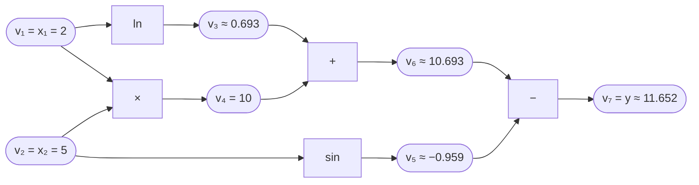
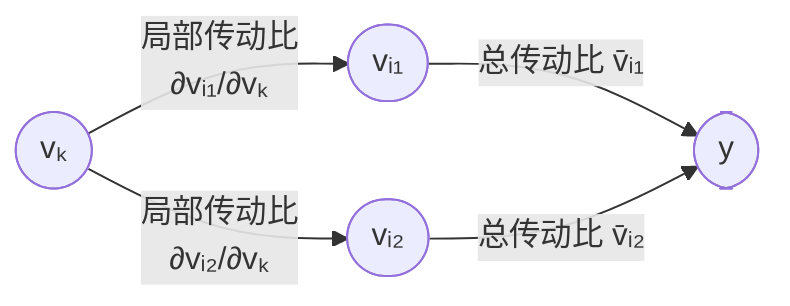
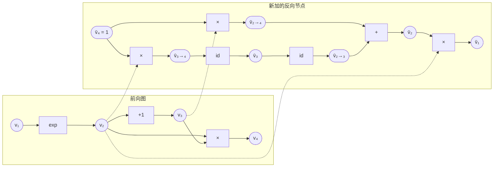

# Lecture 4 · Automatic Differentiation

> **课程**：CMU 15-442/642 Machine Learning Systems（Spring 2026）
> **讲次**：第 4 讲（2026/01/26，Tianqi Chen）· **Lab 1 在本讲发布**
> **Slides**：<https://mlsyscourse.org/slides/04-automatic-differentiation.pdf>
> **Lab 1**：<https://github.com/mlsyscourse/assignment1>
>
> 📌 本笔记中的图使用 Mermaid 绘制，公式使用 LaTeX。Typora、Obsidian、GitHub 可以直接显示；VS Code 需要安装 *Markdown Preview Mermaid Support* 插件。

---

## 0. 一句话总结

**训练要算 loss 对所有参数的梯度。** 数值微分太慢太不准，符号微分重复计算太多，于是有了**自动微分**：把函数拆成计算图上的基本运算，用链式法则把每个运算的局部导数串起来。深度学习有「输入（参数）极多、输出（loss）只有 1 个」的特点，所以用**反向模式**。现代框架的做法是**扩展计算图**：为伴随值构建新的图节点。这样一来，反向也是一张图，可以继续优化、甚至再求一次导。

---

## 第一部分：求导的三种方法

### 1. 为什么关心求导（第 4 页）

训练的每一步都要计算 $\nabla_\theta \text{loss}$，这是训练中最常做的运算。问题是：怎样让计算机**又准又快**地算出它？

### 2. 三种方法对比

| 方法 | 做法 | 问题 | 用途 |
|---|---|---|---|
| **数值微分** | 用导数定义近似：拨动参数，看输出变化 | 不准（截断误差 vs 舍入误差）；n 个参数要算 n～2n 次 f | **梯度检查**：给 AD 实现做单元测试 |
| **符号微分** | 对公式套求导法则，推出导数表达式 | 表达式膨胀，大量重复计算 | — |
| **自动微分** | 在计算图上对每个基本运算用局部导数，链式法则串起来 | — | ✅ 所有现代框架 |

#### 2.1 数值微分（第 5–6 页）

$$
\text{单侧：}\ \frac{\partial f}{\partial \theta_i} \approx \frac{f(\theta+\epsilon e_i)-f(\theta)}{\epsilon}\ \ (O(\epsilon))
\qquad
\text{中心：}\ \frac{\partial f}{\partial \theta_i} \approx \frac{f(\theta+\epsilon e_i)-f(\theta-\epsilon e_i)}{2\epsilon}\ \ (O(\epsilon^2))
$$

- ε 大 → 近似误差大；ε 小 → 两个接近的浮点数相减，舍入误差大。
- 10⁸ 个参数，用中心差分要计算 **2×10⁸ 次** loss。

**梯度检查**：随机选单位方向 δ，比较

$$
\delta^\top \nabla_\theta f \quad \text{vs.} \quad \frac{f(\theta+\epsilon\delta)-f(\theta-\epsilon\delta)}{2\epsilon}
$$

只需算两次 f。但它只得到梯度在一个方向上的**投影（一个标量）**，足以发现 bug，却**还原不出完整的梯度向量**，所以不能替代反向传播。

#### 2.2 符号微分的问题（第 7 页）

$$
f(\theta)=\prod_{i=1}^n \theta_i,\qquad \frac{\partial f}{\partial \theta_k}=\prod_{j\neq k}\theta_j
$$

每个偏导数要 n−2 次乘法，n 个偏导数一共 **n(n−2)** 次。但这些乘积大量重叠，聪明的方法只需 O(n) 次。

---

## 第二部分：前向模式与反向模式

### 3. 例子：计算图与前向求值（第 8 页）

$$
y=\ln(x_1)+x_1x_2-\sin(x_2),\qquad x_1=2,\ x_2=5
$$



⚠️ v₁ 流向 ln 和 ×，v₂ 流向 × 和 sin，**每个输入都有两条路径**。

### 4. 前向模式（第 9–10 页）

定义 $\dot v_i=\partial v_i/\partial x_1$，**沿前向顺序**和值一起算：

| 节点 | 规则 | $\dot v_i$ |
|---|---|---|
| $\dot v_1$ | 种子 | 1 |
| $\dot v_2$ | x₂ 不随 x₁ 变 | 0 |
| $\dot v_3$ | $\dot v_1/v_1$ | 0.5 |
| $\dot v_4$ | $\dot v_1 v_2+v_1\dot v_2$ | 5 |
| $\dot v_5$ | $\dot v_2\cos v_2$ | 0 |
| $\dot v_6$ | $\dot v_3+\dot v_4$ | 5.5 |
| $\dot v_7$ | $\dot v_6-\dot v_5$ | **5.5** |

**局限**：一次传递只能得到所有输出对**一个输入**的导数。f: ℝⁿ → ℝᵏ 需要 **n 次**。深度学习的 n 是上亿，不可行。

### 5. 反向模式（第 12 页）

定义**伴随值** $\bar v_i=\partial y/\partial v_i$，**沿反向拓扑序**从输出往回算：

| 节点 | 计算 | $\bar v_i$ |
|---|---|---|
| $\bar v_7$ | 种子 ∂y/∂y | 1 |
| $\bar v_6$ | $\bar v_7\cdot 1$ | 1 |
| $\bar v_5$ | $\bar v_7\cdot(-1)$ | −1 |
| $\bar v_4$ | $\bar v_6\cdot 1$ | 1 |
| $\bar v_3$ | $\bar v_6\cdot 1$ | 1 |
| $\bar v_2$ | $\bar v_4\cdot v_1+\bar v_5\cdot\cos v_2=1\times2+(-1)\times0.284$ | **1.716** |
| $\bar v_1$ | $\bar v_4\cdot v_2+\bar v_3\cdot\frac{1}{v_1}=5+0.5$ | **5.5** |

验算：$\partial y/\partial x_1=1/x_1+x_2=5.5$ ✅，$\partial y/\partial x_2=x_1-\cos x_2=1.716$ ✅

**一次反向传递，同时得到 y 对所有输入的导数。**

| | 前向模式 | 反向模式 |
|---|---|---|
| 一次传递得到 | 所有输出对**一个输入**的导数 | **一个输出**对所有输入的导数 |
| f: ℝⁿ → ℝᵏ 需要 | **n** 次（看输入个数） | **k** 次（看输出个数） |
| 适合 | 输入少、输出多 | 输入多、输出少（**深度学习：k = 1**） |

> ⚠️ **乘法的导数是另一个因子**：$v_4=v_1v_2\Rightarrow\partial v_4/\partial v_2=v_1$（不是 1）。

### 6. 多条路径要相加（第 13 页）

$$
\bar v_{k\to i}=\bar v_i\cdot\frac{\partial v_i}{\partial v_k},
\qquad
\bar v_k=\sum_{i\in\text{next}(k)}\bar v_{k\to i}
$$

一个量同时影响多个下游，它对最终结果的总影响等于各条路径的影响之和（多元链式法则）。

### 7. 反向模式算法（第 14 页）

```python
def gradient(out):
    node_to_grad = {out: [1]}              # 节点 → 收到的部分伴随值列表
    for i in reverse_topo_order(out):      # 从输出往输入走
        v_bar_i = sum(node_to_grad[i])     # ① 汇总所有路径的份额
        for k in inputs(i):                # ② 对 i 的每个输入 k
            v_bar_k_to_i = v_bar_i * dv_i/dv_k    #    沿 k→i 传回的份额
            node_to_grad[k].append(v_bar_k_to_i)
    return v_bar_input
```

- **为什么按反向拓扑序**：处理 i 时，i 的所有下游都已处理完，它的份额已经收齐。
- **为什么先存列表再求和**：份额从不同下游陆续传来，轮到这个节点时一次性加总。

---

## 第三部分：深入理解「伴随值」

### 8. 伴随值到底是什么

$$
\bar v_i=\frac{\partial y}{\partial v_i}
$$

**把中间值 vᵢ 轻轻推动一点点，最终输出 y 会跟着变化多少？** 它衡量的是输出对这个节点的**敏感度**，也就是「放大倍数」：正负号是方向，绝对值是影响大小。PyTorch 里它就是张量的 `.grad`。

**数值验证**：x₁ 从 2 改成 2.01，y 增加约 0.0550 = 5.5 × 0.01 = $\bar v_1\times 0.01$ ✅

### 9. 与前向模式 $\dot v$ 的区别

| | $\dot v_i=\partial v_i/\partial x_1$ | $\bar v_i=\partial y/\partial v_i$ |
|---|---|---|
| 固定的是 | **分母**（某个输入） | **分子**（最终输出） |
| 问的问题 | 推一下输入，**这个节点**怎么变？ | 推一下**这个节点**，输出怎么变？ |
| 视角 / 方向 | 站在输入端，往前算 | 站在输出端，往回算 |

### 10. 齿轮比喻：局部 × 全局



$$
\bar v_k=\bar v_{i_1}\cdot\frac{\partial v_{i_1}}{\partial v_k}+\bar v_{i_2}\cdot\frac{\partial v_{i_2}}{\partial v_k}
$$

| | 局部导数 ∂vᵢ/∂vₖ | 伴随值 v̄ᵢ |
|---|---|---|
| 依赖什么 | 只依赖这个运算和它的输入 | 依赖之后的**整张图** |
| 谁知道 | 运算自己知道 | 从输出一路传回来才知道 |

> 💡 **对系统设计的意义**：每种运算只需要实现自己的局部求导规则（Lab 1 里要为每种运算写一条），组合工作由通用的反向遍历算法完成。

### 11. 常见误区

1. **伴随值 ≠ 节点的值**：v₄ = 10，v̄₄ = 1，是附着在同一个节点上的两个不同的数。张量的伴随值与张量**同形**。
2. **永远相对于一个固定输出**（loss）。换一个输出，伴随值全变。
3. **参数的伴随值就是 SGD 用的梯度**（上一讲的 `W_grad` = W̄）。中间节点的伴随值只是中转站，PyTorch 默认只保留叶子张量的 `.grad`。
4. **伴随值为 0**：在当前位置，稍微改动这个节点不影响输出。例如 ReLU 输入为负时，梯度在这里被截断。

---

## 第四部分：反向模式 AD 的实现

### 12. 扩展计算图（第 15–20 页）

**关键转变：不直接算伴随值的数值，而是往图里添加计算它的节点。**（这就是上一讲 `tf.gradients` 做的事。）

前向图：$v_2=\exp(v_1),\quad v_3=v_2+1,\quad v_4=v_2\times v_3$

按 4 → 3 → 2 → 1 的顺序处理：

| 步骤 | node_to_grad 中收到的份额 | 添加的节点 |
|---|---|---|
| **i = 4** | [1] | v̄₄ = 1；v̄₂→₄ = v̄₄ × **v₃**；v̄₃→₄ = v̄₄ × **v₂** |
| **i = 3** | [v̄₃→₄] | v̄₃ = id(v̄₃→₄)；v̄₂→₃ = v̄₃（+1 的导数为 1） |
| **i = 2** | [v̄₂→₄, v̄₂→₃] | v̄₂ = v̄₂→₄ **+** v̄₂→₃；v̄₁→₂ = v̄₂ × **v₂**（exp 的导数是自身） |
| **i = 1** | [v̄₁→₂] | v̄₁ = id(v̄₁→₂) ← 所求 |



> 虚线表示**反向节点要用到的前向值**：v₃（给 v̄₂→₄）和 v₂（给 v̄₃→₄、v̄₁→₂）。

**两个要点：**

1. **反向用到前向值**，所以前向的中间结果必须保留（或者到时重算，见显存优化那一讲）。如果前向算完立即释放，反向就无法进行。
2. **此时还没算出任何数**：和 TF1 一样，执行这张图时才有数值。

### 13. 反向传播 vs 反向模式 AD（第 21、24 页）

| | 传统反向传播 | 反向模式 AD（扩展计算图） |
|---|---|---|
| 做法 | 在同一张前向图上倒着执行，每层 `backward()` 直接算数值 | 为伴随值**构建新节点**，得到更大的图再统一执行 |
| 代表 | Caffe、cuda-convnet | TensorFlow、PyTorch 等现代框架 |
| 反向能否被图优化 | ❌ | ✅ 融合、显存规划等全部可用 |
| 梯度的梯度 | ❌ 需为每层手写「backward 的 backward」 | ✅ 对反向图再做一次 AD |
| 按需计算 | 一般整个跑完 | 只执行目标依赖的节点 |
| 代价 | 简单 | 图更大，实现更复杂 |

**核心一句话**：把反向也变成图，图上的所有能力（优化、调度、再求导）就都能用在反向上。

### 14. 张量上的反向模式（第 22 页）

- 张量 Z 的伴随值 Z̄ 与 Z **同形**：$\bar Z_{ij}=\partial y/\partial Z_{ij}$。
- **矩阵乘法** Z = XW（X: m×n，W: n×k，Z: m×k）：

$$
\bar X=\bar Z\,W^\top,\qquad \bar W=X^\top\bar Z
$$

**推导** X̄：$Z_{ij}=\sum_l X_{il}W_{lj}$，Xᵢₗ 影响第 i 行所有的 Zᵢⱼ，所以

$$
\bar X_{il}=\sum_j\bar Z_{ij}W_{lj}=(\bar ZW^\top)_{il}
$$

**形状检查法**（记不住公式时用）：

```
X̄  =  Z̄   ·  Wᵀ          W̄  =  Xᵀ   ·  Z̄
m×n   m×k    k×n          n×k   n×m    m×k   ✅
```

> ⚠️ W̄ 是 **∂y/∂W**（与 W 同形），**不是** ∂Z/∂W（四维雅可比张量）。反向模式的妙处就在于永远不用显式算出这个大张量。

**例子**：X 为 32×784，W 为 784×10 → Z̄ 为 32×10，W̄ = XᵀZ̄ 为 784×32 · 32×10 = **784×10** ✅。batch 维（32）在相乘时被求和消掉，相当于把 32 个样本的梯度加起来，这和 SGD「梯度对样本求和」是同一件事。

### 15. 梯度的梯度（第 25 页）

反向模式 AD 的**输出本身就是一张由普通运算组成的计算图**。AD 的输入和输出是同一种东西，所以可以把输出再喂给 AD，得到二阶导数。

例：y = x³ → 第一次 AD 得到计算 3x² 的图 → 第二次 AD 得到 6x。

**这是 Lab 1（Homework 1）的一部分。**

### 16. 数据结构上的反向模式（第 26 页）

**伴随值和前向值用同一种数据类型。** 例如 d = {"cat": a, "dog": b}，c = lookup(d, "cat")，那么 d̄ = {"cat": c̄}，只有被查找的键收到伴随值。

只要为每种数据类型定义「伴随值长什么样」、为每种运算定义「伴随值怎么传播」，AD 就能推广到任意数据结构。

---

## 17. 课堂检查题回顾

### 第一段

**Q1. 10⁸ 个参数用中心差分要算几次 loss？梯度检查为何不能替代反向传播？**

- 我的回答：2×10⁸ 次；梯度检查是理想情况下的信息，不是真实训练的误差信息。
- 讲评：次数 ✅。理由偏了：梯度检查只得到梯度在一个方向上的**投影（一个标量）**，训练需要完整的 10⁸ 维向量；要还原它，得测 n 个方向，又回到 n 次计算。

**Q2. f: ℝ³ → ℝ¹⁰⁰⁰，两种模式各需几次？**

- 我的回答：前向 1000 次，反向 3 次，选前向。
- 讲评：结论 ✅，但次数写反了。前向看**输入**个数 → 3 次；反向看**输出**个数 → 1000 次。

**Q3. 计算 v̄₂。**

- 我的回答：v̄₄·∂v₄/∂v₂ + v̄₅·∂v₅/∂v₂ = 1 + (−1)×0.284 = 0.716。
- 讲评：两条路径和求和的结构 ✅。错在 ∂v₄/∂v₂ = v₁ = 2（乘法的导数是另一个因子），正确答案为 2 − 0.284 = **1.716**。

### 伴随值小检查

**v₃ = 0 时，v̄₂→₄ 是多少？**

- 我的回答：0，因为 v₃ = 0 时推动 v₂ 影响不到 v₄。✅
- 补充：只有这一条路径的份额为 0；v₂ 还经过 v₃ 影响 v₄（v̄₂→₃ = v̄₄ × v₂），所以总的 v̄₂ 一般不为 0。

### 第二段

**Q1. 哪些反向节点用到前向值？前向算完立即释放会怎样？**

- 我的回答：v₃ 的伴随值和 v̄₂→₄ 分别用到 v₂ 和 v₃；释放后反向需要时找不到。
- 讲评：基本对，但漏了 **v̄₁→₂ = v̄₂ × v₂**（exp 的反向用自己的输出）。应对办法：保留（占显存）或重算（rematerialization，后面的显存优化讲次）。

**Q2. X: 32×784，W: 784×10，求 Z̄、W̄ 形状和公式。**

- 我的回答：Z 为 32×10，W̄ 为 784×10，W̄ = ∂Z/∂W = XᵀZ̄。
- 讲评：形状和 XᵀZ̄ ✅。**记号错误**：W̄ 是 ∂y/∂W，不是 ∂Z/∂W。补上形状验证：784×32 · 32×10 = 784×10 ✅；batch 维被求和消掉。

**Q3. 为什么扩展计算图能求梯度的梯度，而传统反向传播很难？**

- 我的回答：扩展计算图可以使用 AD 直接计算，传统反向传播不能。
- 讲评：太笼统。关键在于：AD 的**输出是一张由普通运算组成的计算图**，输入、输出是同一种东西，所以能再喂给 AD；传统 `backward()` 直接算出数值，不产生图，没有东西可以再求导。

---

## 18. 自测题（先自己答，再展开对照）

**1. 用中心差分算梯度，ε 为什么不能取得太小？**

<details><summary>参考答案</summary>

f(θ+εδ) 和 f(θ−εδ) 会非常接近，两个接近的浮点数相减，有效位数大量丢失（舍入误差），再除以很小的 2ε 会把误差放大。ε 太大则截断误差大，所以要取一个折中值。

</details>

**2. 设 y = x₁·x₂ + x₂²，在 (x₁, x₂) = (3, 2) 处，用反向模式求 ∂y/∂x₁ 和 ∂y/∂x₂。写出中间节点和每一步的伴随值。**

<details><summary>参考答案</summary>

前向：v₁ = 3，v₂ = 2，v₃ = v₁v₂ = 6，v₄ = v₂² = 4，v₅ = v₃ + v₄ = 10 = y。

反向：v̄₅ = 1；v̄₃ = 1，v̄₄ = 1；
v̄₁ = v̄₃ · v₂ = 2；
v̄₂ = v̄₃ · v₁ + v̄₄ · 2v₂ = 3 + 4 = **7**（两条路径相加）。

验算：∂y/∂x₁ = x₂ = 2 ✅；∂y/∂x₂ = x₁ + 2x₂ = 7 ✅。

</details>

**3. 为什么深度学习用反向模式而不是前向模式？用「次数」回答。**

<details><summary>参考答案</summary>

f: ℝⁿ → ℝᵏ，前向模式需要 n 次（输入个数），反向模式需要 k 次（输出个数）。深度学习的 n 是参数量（上亿），k = 1（loss），反向模式只需 1 次。

</details>

**4. 在反向模式算法中，如果不按反向拓扑序处理节点，可能出什么错？**

<details><summary>参考答案</summary>

处理节点 i 时，它的某些下游可能还没处理，这些下游的份额还没传回 `node_to_grad[i]`。这时求和得到的 v̄ᵢ 不完整，于是 v̄ᵢ 和由它往上游传的所有伴随值都会算错。

</details>

**5. Z = XW，X 为 64×512，W 为 512×256。写出 X̄ 的公式并用形状验证。**

<details><summary>参考答案</summary>

X̄ = Z̄Wᵀ。Z̄ 为 64×256，Wᵀ 为 256×512，乘积为 64×512，与 X 同形 ✅。

</details>

**6. 「扩展计算图」相比传统反向传播有哪些好处？至少说两点。**

<details><summary>参考答案</summary>

反向也是图，可以做融合、显存规划等图优化；可以对反向图再做 AD，得到高阶导数；可以只执行目标依赖的节点（按需计算）。

</details>

**7. exp 的反向规则有什么特别之处？这对显存有什么影响？**

<details><summary>参考答案</summary>

d exp(x)/dx = exp(x)，所以 v̄_in = v̄_out × **exp 的输出**。反向需要保留的是 exp 的**输出**，而不是它的输入。只要输出保留着，输入就可以释放。系统做显存规划时，必须知道每种运算的反向需要哪些前向值。

</details>

**8.（综合）`tf.gradients(loss, [W])` 内部大致在做什么？用本讲的概念描述。**

<details><summary>参考答案</summary>

从 loss 出发（种子 v̄ = 1），按反向拓扑序遍历前向图。对每个节点，先把收到的部分伴随值求和（必要时添加加法节点），再根据该运算的局部求导规则，为它的每个输入**添加**计算部分伴随值的新节点（可能引用前向值），存进 `node_to_grad`。最后返回 W 的伴随值节点的句柄。整个过程只建图，不计算数值。

</details>

---

## 19. 推荐视频与辅助资源

| 资源                                                                                                    | 补什么                                   | 建议                  |
| ----------------------------------------------------------------------------------------------------- | ------------------------------------- | ------------------- |
| CMU 10-414 Lecture 4: **Automatic Differentiation**<br/><https://youtu.be/56WUlMEeAuA>                | 陈天奇讲同一套内容（数值/符号/前向/反向模式、扩展计算图），例子基本一致 | ⭐ **建议看**，适合复习      |
| CMU 10-414 Lecture 5: **Automatic Differentiation Implementation**<br/><https://youtu.be/cNADlHfHQHg> | 在代码层面演示如何实现计算图节点与反向模式 AD              | ⭐ **做 Lab 1 之前建议看** |

> 视频链接取自 10-414 官方课程页 <https://dlsyscourse.org/lectures/>（2022 年版本的录像）。注意 10-414 的框架（needle）API 和本课 Lab 1 不完全相同，看思路即可，不要照搬代码。
