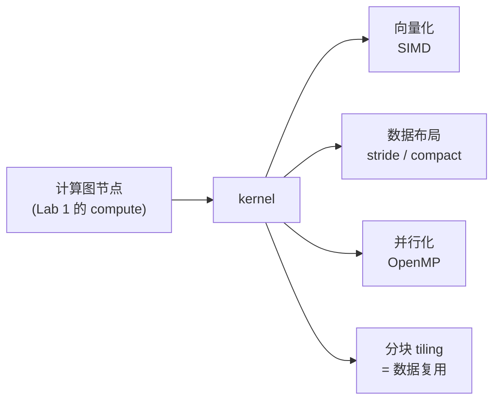
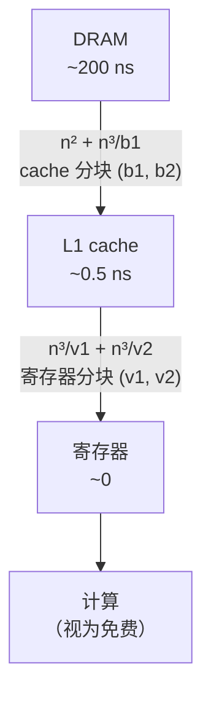

# Lecture 5 · Hardware Acceleration（线性代数优化）

> **课程**：CMU 15-442/642 Machine Learning Systems（Spring 2026）
> **讲次**：第 5 讲 · 硬件加速
> **Slides**：<https://mlsyscourse.org/slides/05-hardware-acceleration.pdf>
>
> 📌 本笔记中的图使用 Mermaid 绘制，公式使用 LaTeX。Typora、Obsidian、GitHub 可以直接显示；VS Code 需要安装 *Markdown Preview Mermaid Support* 插件。

---

## 0. 一句话总结

计算图里每个节点的 `compute` 最终都要变成跑在硬件上的 kernel。让 kernel 变快有三板斧：**向量化**（一条指令处理多个数据）、**数据布局**（决定访存是否连续）、**并行化**（多核同时算）。以矩阵乘法为例，**计算可以先当作免费，真正的成本是访存**：寄存器分块和 cache 分块分别减少「L1→寄存器」和「DRAM→L1」两层的读取量，本质都是**数据复用**：某个访问不依赖某个循环变量，就能沿这个循环复用。



---

## 第一部分：通用加速技巧

### 1. 向量化（第 7 页）

两个长度 256 的 float 数组相加：用 128 位向量指令，一次加载、计算、存储 4 个 float，循环从 256 次变为 64 次。

- 对应 61C Lab 9 的 SSE intrinsics。
- **对齐要求**：A、B、C 需按 128 位（16 字节）对齐。`_mm_load_ps` 要求对齐，`_mm_loadu_ps` 不要求但可能更慢。

### 2. 数据布局与 stride（第 8–9 页）⭐

内存是一维的，A[i, j] 的偏移量（以**元素**为单位）：

| 布局 | 偏移量 | strides |
|---|---|---|
| 行主序（C、NumPy 默认） | `i * 列数 + j` | `(列数, 1)` |
| 列主序（Fortran） | `j * 行数 + i` | `(1, 行数)` |
| **一般 strided** | `i * stride[0] + j * stride[1]` | 任意 |

张量 = **一块一维内存 + 形状 + strides + 起始偏移**。

**例**：3×4 float32 矩阵，行主序。

- 以元素为单位：`A.strides = (4, 1)`，`A.T.strides = (1, 4)`
- 以字节为单位（NumPy 的 `.strides`）：各乘 4，即 `(16, 4)` 和 `(4, 16)`
- `A[2][1]` 偏移 = 2·4 + 1·1 = **9**

#### 2.1 零拷贝操作：只改元数据

| 操作 | 怎么做 |
|---|---|
| 切片 `A[1:, :]` | 改起始偏移和形状 |
| 转置 `A.T` | **交换两个 stride** |
| 广播 | **被广播的维度 stride = 0** |

```python
a = np.arange(6, dtype=np.float64).reshape(2, 3)
a.strides                               # (24, 8)  字节
a.T.strides                             # (8, 24)  交换了
np.broadcast_to(np.array([10., 20.]), (3, 2)).strides   # (0, 8)
```

**与 Lab 1 的联系**：`BroadcastOp.compute` 里的 `np.broadcast_to` 没有复制数据，返回的是行方向 stride 为 0 的视图。

**为什么广播结果是只读的？** stride = 0 造成**别名**（aliasing）：多个逻辑上不同的元素是同一个内存位置。写 `out[0][1]` 会让 `out[1][1]`、`out[2][1]` 甚至原数组一起变。

#### 2.2 stride 的代价：不连续访存

> **口诀：沿哪个下标走，就看哪个位置的 stride。先确定是谁的 strides，再确定是第几个。**

沿 `A.T[i][j]` 的一行走 = j 在变 = 步长是 **A.T.strides[1]**（等于 A.strides[0]）。

| 读 16 个 float32（1024×1024 矩阵） | 相邻元素间隔 | cache line 数 | 利用率 |
|---|---|---|---|
| 沿 A 的一行 | 4 字节 | 1 | 100% |
| 沿 A.T 的一行 | 4096 字节 | 16（每个元素一条） | 4/64 = 1/16 |

两个代价：**向量化困难**（向量加载要求连续）+ **cache 利用率低**。

解决办法：计算前 **compact**（`np.ascontiguousarray` / `.contiguous()`），复制成连续布局。权衡：视图便宜，但后续计算可能变慢；何时 compact 是 ML 编译器的决策之一。

### 3. 并行化（第 10 页）

`#pragma omp parallel for` 把循环迭代分给多个线程（61C Lab 10）。

**三者关系**：向量化 = 单核内一条指令多个数据；并行化 = 多核同时；布局决定前两者能否高效发挥。

---

## 第二部分：矩阵乘法案例

计算 `C = A · Bᵀ`，即 $C_{ij} = \sum_k A_{ik} B_{jk}$。这样 A、B 都**按行读**，行主序下都连续。

### 4. 成本模型（第 13–14 页）

| 层级 | 延迟 |
|---|---|
| 寄存器 | ~0 |
| L1 | ~0.5 ns |
| L2 | ~7 ns |
| DRAM | ~200 ns |

**计算当作免费，只统计每层读了多少数据**（roofline 分析的雏形）。

**朴素版本**：最内层执行 n³ 次，每次从 DRAM 读 A、B 各一个元素 → $2 \cdot \text{dram} \cdot n^3$。

### 5. 寄存器分块（第 15–16 页）

```
for i in range(n/v1):
  for j in range(n/v2):
    c[v1][v2] = 0                 # 寄存器，k 循环前定义，一直复用
    for k in range(n/v3):
      a = A[i, k]    # v1×v3 → 寄存器
      b = B[j, k]    # v2×v3 → 寄存器
      c += a · bᵀ
    C[i, j] = c                   # 每个 C 元素只写回一次
```

**推导方法：读取总量 = 执行次数 × 每次读取量**

$$
L_A = \frac{n}{v_1}\cdot\frac{n}{v_2}\cdot\frac{n}{v_3}\cdot v_1 v_3 = \frac{n^3}{v_2},\qquad
L_B = \frac{n}{v_1}\cdot\frac{n}{v_2}\cdot\frac{n}{v_3}\cdot v_2 v_3 = \frac{n^3}{v_1}
$$

- **直觉**：一个 A 小块被 B 小块的 v2 行复用，所以读取量降为 1/v2。
- **寄存器代价**：$v_1 v_3 + v_2 v_3 + v_1 v_2$。
- v3 不出现在读取成本中，所以令 **v3 = 1**。

#### 5.1 方形小块最优（16 个寄存器，v3 = 1）

| (v1, v2) | 寄存器 v1v2+v1+v2 | 可行 | 成本 |
|---|---|---|---|
| (1, 7) | 15 | ✅ | 1.14 n³ |
| (2, 4) | 14 | ✅ | 0.75 n³ |
| **(3, 3)** | 15 | ✅ | **0.67 n³** |
| (2, 5) | 17 | ❌ | — |

成本 $= n^3 \cdot \frac{v_1+v_2}{v_1 v_2}$：分子是 A、B 小块占用的寄存器，分母是 C 小块面积（复用来源）。**v1 + v2 固定时，v1 = v2 乘积最大**（均值不等式）。GPU GEMM 中每个线程的小块通常是 4×4、8×8，就是这个原因。

### 6. Cache 分块（第 17–18 页）

```
for i in range(n/b1):
  a = A[i]           # b1 × n，DRAM → L1（只在外层）
  for j in range(n/b2):
    b = B[j]         # b2 × n，DRAM → L1（随 i 重复）
    C[i, j] = dot(a, bᵀ)    # 内部用寄存器分块
```

$$
L_A = \frac{n}{b_1}\cdot b_1 n = n^2,\qquad
L_B = \frac{n}{b_1}\cdot\frac{n}{b_2}\cdot b_2 n = \frac{n^3}{b_1}
$$

**约束**：
- $b_1 n + b_2 n \le$ L1 容量（两块同时放得下）
- $b_1 \bmod v_1 = 0$，$b_2 \bmod v_2 = 0$（内层小块整除外层块）

### 7. 合并成本（第 19 页）

$$
\underbrace{\text{dram}\cdot\left(n^2 + \frac{n^3}{b_1}\right)}_{\text{DRAM}\to\text{L1，cache 分块决定}}
+
\underbrace{\text{l1}\cdot\left(\frac{n^3}{v_2} + \frac{n^3}{v_1}\right)}_{\text{L1}\to\text{寄存器，寄存器分块决定}}
$$



### 8. 核心思想：数据复用（第 20–22 页）

在 $C_{ij} \mathrel{+}= A_{ik} B_{jk}$ 中：

| 访问 | 不依赖 | 可沿该循环复用 |
|---|---|---|
| A[i][k] | j | ✅ |
| B[j][k] | i | ✅ |
| C[i][j] | k | ✅（累加器常驻寄存器） |

> **通用规则：某个访问不依赖某个循环变量，就能沿这个循环被复用。分块 = 把复用框在快的存储层里。**

**卷积**：权重不依赖输出空间位置 (h, w)，可沿空间复用；一个输入像素被多个滑动窗口共用。

---

## 9. 通往 GPU 项目（P1）

| CPU（本讲） | GPU（P1 FP32 GEMM） |
|---|---|
| DRAM | Global memory（GDDR7） |
| L1 cache 分块 (b1, b2) | **Shared memory** 分块，手动管理 |
| 寄存器分块 (v1, v2) | 每线程的 thread tile |
| `C = A·Bᵀ` 让访存连续 | 合并访存（coalescing） |

P1 路线：朴素 kernel → shared memory 分块 → 寄存器分块，每一步都可以用本讲公式预测读取量。

---

## 10. 易错点（来自本讲的检查题）

| 错误 | 正确做法 |
|---|---|
| 题目要「元素」单位的 strides，给了字节；或把 float64 的 8 字节套到 float32 | 先看单位、再看 dtype：float32 = 4 字节 |
| 只写公式不代数 | 偏移、成本都要算出具体数字 |
| 说「隔 strides[1] 个元素」不说是谁的 | A.strides[1] = 1，A.T.strides[1] = 4，结论完全相反 |
| 把小例子的步长套到大矩阵上 | 题目换了 n，步长要重算 |
| 用「间隔 ÷ 64」算 cache line 数 | 间隔 ≥ 64 字节时，**每个元素各占一条**：读 k 个元素就是 k 条 |
| 利用率算出来和 n 有关 | 利用率 = 用到的字节 / 64，分母与矩阵大小无关 |
| 「方形最优」用圆来类比 | 约束是 (v1+1)(v2+1) ≤ 17（双曲线）；用均值不等式解释 |

---

## 11. 自测题

<details>
<summary>Q1. 一个 5×8 float32 行主序矩阵，以字节为单位，A 和 A.T 的 strides 各是多少？A[3][2] 的元素偏移是多少？</summary>

元素单位：A (8, 1)，A.T (1, 8)。字节：A (32, 4)，A.T (4, 32)。偏移 = 3·8 + 2·1 = 26。

</details>

<details>
<summary>Q2. 把形状 (4,) 的向量广播到 (3, 4)，结果的 strides（元素单位）是多少？为什么只读？</summary>

(0, 1)。行方向 stride 为 0，三行指向同一块内存；写入会因别名同时改动多行和原数组。

</details>

<details>
<summary>Q3. 2048×2048 float32 矩阵，沿 A.T 的一行读 32 个元素，读几条 cache line（64 字节）？利用率？</summary>

间隔 2048·4 = 8192 字节 > 64，每个元素各占一条：32 条，利用率 4/64 = 1/16。

</details>

<details>
<summary>Q4. 寄存器分块中为什么 v3 可以取 1？</summary>

L_A = n³/v2、L_B = n³/v1，v3 被约掉，不影响读取量，却增加 v1v3 + v2v3 个寄存器占用。

</details>

<details>
<summary>Q5. 有 64 个寄存器（v3 = 1），比较 (7, 7) 和 (4, 12)。</summary>

(7,7)：49+14 = 63 ✅，成本 2/7 ≈ 0.286 n³。(4,12)：48+16 = 64 ✅，成本 1/4+1/12 ≈ 0.333 n³。方形更优。

</details>

<details>
<summary>Q6. Cache 分块里，如果交换 i、j 循环的内外层（B 放外层），读取量变成什么？</summary>

L_B = n²，L_A = n³/b2。复用的对象换成了 B，代价换到 A 上。

</details>

<details>
<summary>Q7. 为什么 slides 计算 A·Bᵀ 而不是 A·B？</summary>

C_ij = Σ_k A_ik B_jk 中，A、B 都沿 k 方向（行内）读取，行主序下连续；A·B 的 B 要按列读，步长为 n。

</details>

<details>
<summary>Q8. 用「复用规则」分析：卷积 out[n][co][h][w] += in[n][ci][h+kh][w+kw] · W[co][ci][kh][kw]，W 可沿哪些循环复用？</summary>

W 不依赖 n、h、w，可沿 batch 和输出空间位置复用。

</details>

---

## 12. 推荐视频

- **CMU 10-414/714 Deep Learning Systems · Lecture 11 – Hardware Acceleration**（Tianqi Chen）：<https://youtu.be/es6s6T1bTtI>
  与本讲 slides 内容几乎一一对应（向量化、strides、寄存器/cache 分块、复用分析），可在复习时完整看一遍。
